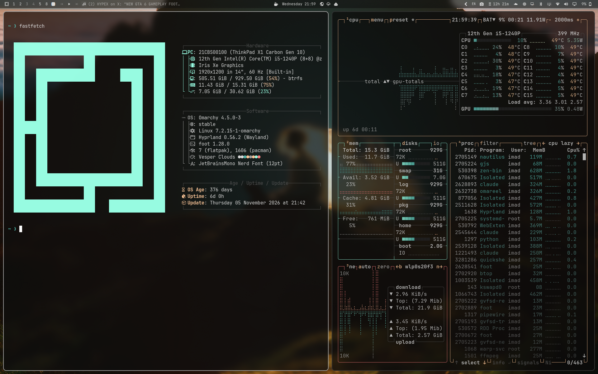

# Vesper Clouds

A warm-monochrome dark theme for [Omarchy](https://omarchy.org), built on the
[Vesper](https://github.com/raunofreiberg/vesper) palette and inspired by
[advtszn's macOS rice](https://github.com/advtszn/dotfiles).



## Install

```bash
omarchy theme install https://github.com/3IMAD69/omarchy-vesper-clouds-theme
```

## Palette

| Role       | Color     |
| ---------- | --------- |
| Background | `#101010` |
| Foreground | `#dadada` |
| Accent     | `#ffc799` |
| Mint       | `#99ffe4` |
| Teal       | `#50b5aa` |
| Red        | `#ff8080` |
| Grey       | `#a0a0a0` |
| Dim        | `#505050` |

Window borders are grey on the focused window and dim on the rest, in place of
the usual accent-colored border.

## Wallpapers

Nine wallpapers ship with the theme. Cycle through them with Super + Ctrl + Space.

<table>
  <tr>
    <td></td>
    <td></td>
  </tr>
  <tr>
    <td></td>
    <td></td>
  </tr>
  <tr>
    <td></td>
    <td></td>
  </tr>
  <tr>
    <td></td>
    <td></td>
  </tr>
  <tr>
    <td></td>
    <td></td>
  </tr>
</table>

## Recommended

For the frosted-glass look in the preview, turn on glassy windows:

```bash
omarchy hyprland window transparency glassy
```

Or use Appearance > Windows > Window Opacity in the Omarchy menu.

VS Code, VSCodium and Cursor get the real Vesper editor colors automatically:
the theme ships Vesper's color theme as `vscode-theme.json`, which Omarchy
loads as its local theme, with no extension to install.

Neovim gets colors generated from the palette. For the real thing, install
[vesper.nvim](https://github.com/datsfilipe/vesper.nvim).

## Credits

- Palette and VS Code theme: [Vesper](https://github.com/raunofreiberg/vesper) by Rauno Freiberg,
  MIT licensed (see `LICENSE-vesper.txt`)
- Wallpapers: from Perplexity's PPLX wallpaper series, via
  [advtszn/dotfiles](https://github.com/advtszn/dotfiles). All rights belong to their owners.
